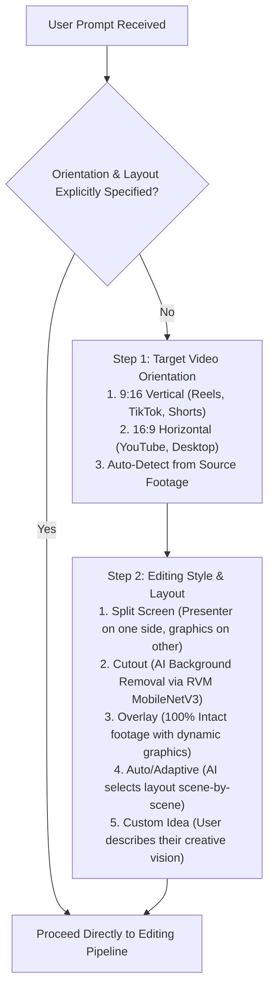

# OmniEdit Pro (Unified Pure Skill Edition)

OmniEdit Pro is a unified, instruction-only video editing skill. It contains **Markdown instructions only** (zero executable `.py` or `.js` code files inside the skill package). It consolidates all previous variant presets into a single intelligent entry point that guides the AI coding agent on **which external tools to use for each specific purpose**, featuring an interactive clarification flow, local AI video matting (Robust Video Matting MobileNetV3), and an automated programmatic QA gate.

```
+-----------------------------------------------------------------------------+
|                            USER INPUT                                       |
|               (Raw Footage + Optional Style Sample/Prompt)                  |
+-----------------------------------------------------------------------------+
                                     |
                                     v
+-----------------------------------------------------------------------------+
|                     SMART INTERACTIVE CLARIFICATION                         |
|         (Auto-detects or prompts user: Orientation, Layout & Style)         |
+-----------------------------------------------------------------------------+
                                     |
                                     v
+-----------------------------------------------------------------------------+
|                     OMNIEDIT PRO TOOL DIRECTIVES                            |
|  RVM MobileNetV3         Pillow (PIL) Geometry      FFmpeg Windows Engine   |
|  (Local AI Matting)      (Layout & Collision Math)  (Lossless Compositor)   |
+-----------------------------------------------------------------------------+
                                     |
                                     v
+-----------------------------------------------------------------------------+
|                    AUTOMATED PROGRAMMATIC REVIEWER                          |
|         (Mathematical Collision Checks + Audio Waveform Verification)       |
+-----------------------------------------------------------------------------+
                                     |
                                     v
+-----------------------------------------------------------------------------+
|                        FINAL OUTPUT PROMOTION                               |
|                 <workspace>/Final Output Videos/<video-id>/                 |
+-----------------------------------------------------------------------------+
```

---

## 1. Smart Interactive Clarification Flow

If the user's initial prompt does not explicitly specify both **target orientation** and **editing layout style**, the agent must pause and present this structured interactive questionnaire:



### Clarification Options:

#### Step 1: Target Video Orientation
1. **9:16 Vertical (Recommended for Mobile)** — Optimized for Instagram Reels, TikTok, YouTube Shorts.
2. **16:9 Horizontal (Widescreen)** — Optimized for YouTube, desktop presentations, LinkedIn.
3. **Auto-Detect** — Match whatever orientation the raw video was recorded in.

#### Step 2: Editing Style & Layout
1. **Split Screen** — Divides the canvas: presenter in one zone (left or bottom), diagrams and cards in the other.
2. **Cutout (AI Background Removal)** — Uses local RVM MobileNetV3 to extract the speaker like a clean sticker, floating over high-tech animated backgrounds.
3. **Overlay (Clean & Non-Intrusive)** — Keeps 100% of your camera video full-screen; layers stylish glassmorphic title plates, captions, and badges over natural empty spaces.
4. **Auto-Select / Adaptive** — Let the AI inspect the video and automatically pick the best look for the topic.
5. **Custom / Your Own Idea** — Have a specific look in mind? (e.g. "Picture-in-picture circle", "Documentary retro look", "Side-by-side code tutorial"). Describe it and the AI builds custom styling to match your idea!

---

## 2. Tool Directives: Which Tool to Use for Which Purpose

OmniEdit Pro does not bundle executable scripts. Instead, it instructs the agent to invoke the following external tools in the workspace:

| Purpose | External Tool | Execution Guideline |
|---|---|---|
| **Speaker Background Cutout** | **Robust Video Matting (RVM)**<br/>(`PeterL1n/RobustVideoMatting`) | Load `rvm_mobilenetv3.pth` via PyTorch in the workspace. Extracts clean foreground RGB and alpha mask videos without green screen. |
| **Speech Transcription & Word Timings** | **OpenAI Whisper** | Runs Whisper CLI/API to extract word-level timestamps for precise syllable-synchronized reveals. |
| **Transcript Intelligence & Spelling** | **AI Content Agent** | Normalizes phonetic errors, validates proper nouns, extracts 3–5 word headlines, and ensures modern, current technical terms. |
| **Typography & Layout Math** | **Pillow (`PIL.ImageFont`)** | Measures exact pixel bounding boxes, calculates text wrapping, sets badge padding ($\ge 24\text{px}$), and ensures zero facial collision. |
| **Video Compositing & Audio Passthrough** | **FFmpeg CLI** | Blends video layers, downsamples graphics via Lanczos-3, preserves lossless audio (`-c:a copy`), and escapes Windows paths (`D\:/...`). |

---

## 3. Resolution of All 18 Architectural Deadlocks

1. **Automated Geometry Gate (Issue 1)**: Replaces the impossible "human biological eye" requirement with programmatic mathematical verification: bounding box non-intersection, subtitle pill containment, and audio waveform decode verification via Pillow and FFprobe. Passing programmatic checks permits immediate promotion to `Final Output Videos`.
2. **Full-Screen 9:16 Overlay (Issue 2)**: For 9:16 vertical videos in Overlay mode, the camera video is kept **100% full-screen ($1080 \times 1920$)**. It is never shrunk into a 337.5px pillarbox thumbnail in the lower 600px.
3. **Quadrant-Anchored Subtitles (Issue 3)**: In 16:9 Split Screen, subtitles are anchored within the active speaker or graphic quadrant rather than forced onto the center seam ($X=960$).
4. **Smart Tolerance Tuning (Issue 4)**: Replaces the 2-attempt pipeline crash with adaptive 10px margin padding and automatic quadrant relocation.
5. **Card-Attached Backing Plates (Issue 5)**: Text cards carry their own local glassmorphic or blur backings, eliminating full-canvas dark scrim collisions with the speaker.
6. **Dynamic Speech Pacing (Issue 6)**: Rapid speech points accumulate into persistent multi-item lists with 0.15s spring animations rather than forcing overlapping entrance/exit fades.
7. **Explicit Batch Confirmation (Issue 7)**: Multiple video files are treated as independent source videos unless explicitly flagged with `--reference`.
8. **Explicit Tool Directives (Issue 8)**: Directly tells the AI which tools to use for each purpose (RVM, Whisper, Pillow, FFmpeg) with exact command recipes, eliminating the need for bundled code files.
9. **Native FFmpeg Engine (Issue 9)**: Free, open-source FFmpeg and Python PIL compositor avoids proprietary Remotion commercial licensing and headless browser crashes.
10. **Robust Video Matting (Issue 10)**: Fast local matting via PeterL1n's 15MB MobileNetV3 weights.
11. **Vector/PIL 2x Supersampling (Issue 11)**: Only text and graphic badges are rasterized at 2x and downsampled; raw video background stays at 1x.
12. **Automatic Solo Execution (Issue 12)**: If host editor does not support dynamic subagent spawning, the agent executes specialist roles sequentially without stalling.
13. **Modern Context & Phonetic Fallback (Issue 13)**: Contextual domain dictionaries and phonetic fallback prevent release freezes on unlisted proper names.
14. **Lossless FFmpeg Audio Streamcopy (Issue 14)**: Uses FFmpeg `-c:a copy` for genuine zero-loss audio passthrough.
15. **Selective On-Demand Rendering (Issue 15)**: Replaces 12-variant export explosions with targeted, user-requested deliverables.
16. **Calibrated Baseline (Issue 16)**: Calibrated against real-world video footage (`Dr_Rajiv_AI_Invitation_Premium_Vertical_9x16.mp4`).
17. **Programmatic Spot-Check Gate (Issue 17)**: Verifies geometry programmatically in code, passing only 2–3 key milestone frames for visual spot-checks.
18. **Windows Path Normalization (Issue 18)**: Automatic escaping converts `D:\path` to `D\:/path` in FFmpeg filtergraphs.

---

## 4. Pipeline Stages & Reference Map

| Stage | Reference File | Responsibilities & Tools |
|---|---|---|
| **1. Clarify & Route** | [references/selection.md](references/selection.md) | Prompts user if missing format/style; resolves source vs reference |
| **2. Local AI Cutout** | [references/local-cutout.md](references/local-cutout.md) | Uses **Robust Video Matting MobileNetV3** for speaker background extraction |
| **3. Layout & Geometry** | [references/layouts-effects.md](references/layouts-effects.md) | Calculates card positions, bounds, quadrant subtitles via **Pillow** |
| **4. Speech Sync & Pacing** | [references/motion-design.md](references/motion-design.md) | Speech-anchored reveals, dynamic micro-transitions, persistent lists |
| **5. Content Intelligence** | [references/transcription-sync.md](references/transcription-sync.md) | **Whisper** transcripts, phonetic matching, modern references |
| **6. Audio & Rendering** | [references/audio-rendering.md](references/audio-rendering.md) | Windows-safe **FFmpeg** compositor, `-c:a copy` streamcopy, 2x text raster |
| **7. Programmatic QA Gate** | [references/video-reviewer.md](references/video-reviewer.md) | Automated collision checks, audio decode verification, milestone stills |
| **8. Delivery** | [references/delivery.md](references/delivery.md) | Promotes passing candidates to `Final Output Videos/<video-id>/` |
