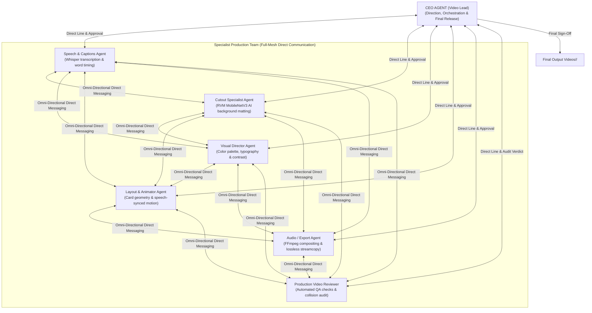

# Multi-Agent Coordination, Parallel Execution, and Team Hierarchy

Read when managing agent teams, assigning specialist roles, orchestrating parallel tasks, and coordinating inter-agent communication.

---

## 1. Team Hierarchy & The CEO Agent (Video Lead)

OmniEdit Pro establishes a structured team hierarchy led by a **CEO Agent (Video Lead)** with **full omni-directional communication** between all team members:



### Roles and Responsibilities:
1. **The CEO Agent (Video Lead)**:
   - Holds overarching project ownership and creative decision-making authority.
   - Inspects the user prompt, determines the editing strategy, and dispatches tasks to specialist subagents.
   - Reviews and approves intermediate outputs before allowing subsequent stages to proceed.
   - Performs the final release sign-off before files are promoted to `Final Output Videos/`.
2. **Speech & Captions Specialist**: Transcribes audio with Whisper, repairs phonetic errors, extracts 3–5 word headlines, and sets millisecond word timestamps.
3. **Visual Director**: Analyzes speaker clothing and background to select WCAG AAA contrast palettes, typefaces, and graphic accents.
4. **Cutout Specialist**: Operates PeterL1n's Robust Video Matting (RVM MobileNetV3) to isolate the speaker's moving silhouette.
5. **Layout & Animator**: Designs syllable-synchronized card animations, padding, and smooth transition curves.
6. **Audio / Export Specialist**: Combines graphic overlays, foreground cutouts, and backgrounds via FFmpeg, muxing original audio via `-c:a copy`.
7. **Independent Production Reviewer**: Audits bounding-box coordinates, verifies audio integrity, and submits the release verdict to the CEO Agent.

---

## 2. High-Speed Parallel Execution (Concurrent Processing)

To minimize turnaround time, tasks with no mutual dependencies execute **in parallel simultaneously**:

- **Concurrent Phase 1 (Data Extraction & Preprocessing)**:
  - `Track A`: The **Speech Specialist** transcribes dialogue and computes syllable timestamps.
  - `Track B`: The **Cutout Specialist** runs RVM MobileNetV3 to extract the alpha matte and foreground.
  - `Track C`: The **Visual Director** samples frame lighting, tests contrast, and finalizes typography.
  *(These 3 heavy tasks run concurrently rather than sequentially, cutting processing time by up to 60%).*
- **Synthesis Phase 2 (Composition & Motion)**:
  - The **Layout & Animator** combines word timings from Track A with visual styling from Track C and gesture boundaries from Track B.
- **Final Assembly Phase 3 (Compositing & QA)**:
  - The **Audio/Export Specialist** combines the alpha cutout from Track B with the motion graphics and encodes the MP4.
  - The **Reviewer** verifies the output and reports back to the CEO Agent.

---

## 3. Full-Mesh (Omni-Directional) Inter-Agent Communication

**Every single agent can communicate directly with ANY other agent at any time** whenever coordination is needed:

```
[CEO] <---> [Speech] <---> [Cutout] <---> [Visuals] <---> [Layout] <---> [Audio/Export] <---> [Reviewer]
  ^                                                                                               ^
  +--------------------------- ANY-TO-ANY COMMUNICATION ------------------------------------------+
```

### Concrete Any-to-Any Communication Scenarios:
1. **Reviewer $\leftrightarrow$ Layout & Animator**:
   - The Reviewer directly messages the Layout Animator: *"On frame 112, card 'AI Innovation' intersects speaker's hand by 4 pixels. Please shift card X by +15px."* The Layout Animator adjusts coordinates immediately without waiting for a re-dispatch cycle.
2. **Cutout Specialist $\leftrightarrow$ Visual Director**:
   - The Cutout Specialist informs the Visual Director: *"Speaker is wearing a dark navy blazer with soft shoulder lighting."* The Visual Director immediately chooses a light-glassmorphic card palette to ensure maximum contrast against the blazer.
3. **Cutout Specialist $\leftrightarrow$ Layout & Animator**:
   - The Cutout Specialist provides real-time silhouette bounding boxes for wide arm gestures so the Layout Animator can avoid animating cards into gesture zones.
4. **Speech Specialist $\leftrightarrow$ Reviewer**:
   - The Reviewer queries the Speech Specialist to verify an ambiguous technical proper name or brand term against the audio waveform before issuing the final release verdict.
5. **Audio / Export $\leftrightarrow$ Speech Specialist**:
   - The Audio Specialist consults the Speech Specialist to confirm natural speech pauses and room-tone decay points so audio transitions occur at natural silence boundaries.
6. **Any Specialist $\leftrightarrow$ CEO Agent**:
   - Any agent can directly escalate creative doubts, ambiguous prompt requirements, or trade-offs to the CEO Agent for an authoritative project decision.

### Communication Channels:
- **Direct Agent Messaging**: Direct inter-subagent messaging in multi-agent environments.
- **Shared Project Ledger (`Working Files/<video-id>/ledger.json`)**: Real-time shared memory containing cues, layout metrics, alpha paths, and QA logs accessible by all agents.

---

## 4. Automatic Solo Pipeline Fallback (Single-Agent Hosts)

In environments without native multi-agent spawning (e.g. standard VS Code, Cursor, Claude Code CLI):
- The single AI agent takes on the CEO role and sequentially executes each specialist role in logical order:
  $$\text{Speech} \rightarrow \text{Cutout} \rightarrow \text{Visuals} \rightarrow \text{Layout} \rightarrow \text{Export} \rightarrow \text{Reviewer}$$
- Quality, geometric precision, and lossless standards remain identical in both multi-agent and solo modes.
